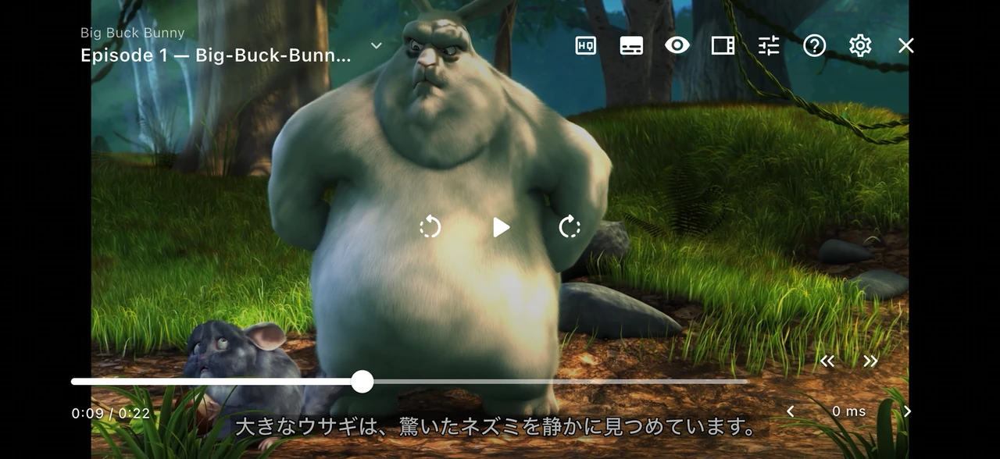
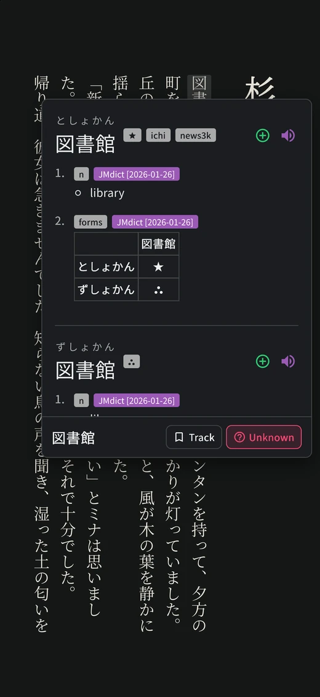
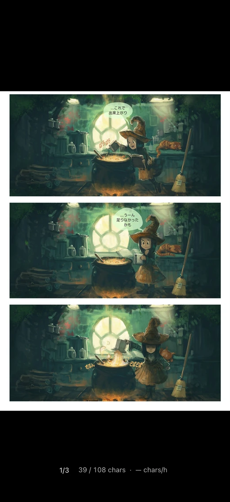
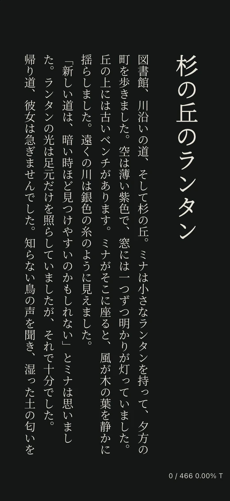
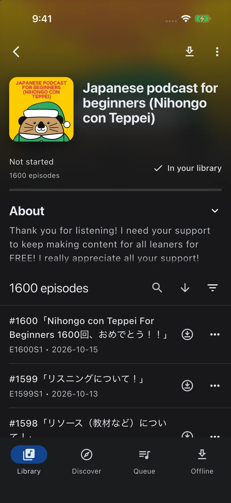
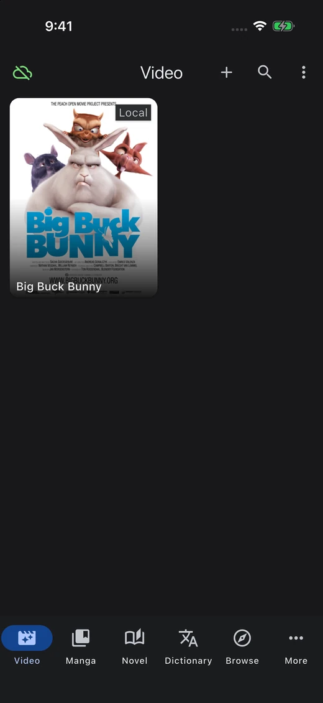

<!-- Generated by scripts/build-readmes.mjs. Edit scripts/readme-locales.json, then regenerate. -->

<h1>Manatan</h1>
<h3>好きな作品から、言語を学ぼう。</h3>

アニメや YouTube を観る。マンガや小説を読む。作品を離れることなく、単語を調べて役立つ例文を保存できます。

[English](../../README.md) | [简体中文](README.zh-CN.md) | [繁體中文](README.zh-Hant.md) | **日本語** | [한국어](README.ko.md) | [Español](README.es.md) | [Français](README.fr.md) | [Deutsch](README.de.md) | [Português](README.pt-BR.md) | [Русский](README.ru.md) | [Tiếng Việt](README.vi.md) | [ภาษาไทย](README.th.md) | [Bahasa Indonesia](README.id.md) | [Italiano](README.it.md) | [Nederlands](README.nl.md) | [Türkçe](README.tr.md) | [العربية](README.ar.md)

 

[公式サイト](https://manatan.com) · [画像付きセットアップガイド](https://manatan.com/blog/getting-started-manatan) · [ドキュメント](https://manatan.com/docs)

  

<em>自分のコンテンツ、操作できる字幕、必要な場所ですぐ使える学習ツール。</em>

## 作品を楽しむところから復習まで、ひとつのアプリで

- **観る、読む、聴く。** ローカル動画、YouTube、マンガ、EPUB、Web 小説、ポッドキャストをひとつのアプリで楽しめます。
- **文脈の中で理解する。** インポートした辞書で単語を調べ、端末上のマンガ OCR やインタラクティブな字幕を活用できます。
- **大切な表現を残す。** 例文を保存し、利用可能な場合は音声や画像も追加できます。アカウント同期に対応した Manatan SRS で復習するか、Anki を引き続き使えます。

## プラットフォームを選ぶ

| 環境 | ダウンロード / 開く | 選択肢 |
| --- | --- | --- |
| Windows | [インストーラー](https://manatan.com/download) | x64 |
| macOS | [Mac アプリ](https://manatan.com/download) | Apple Silicon / Intel |
| Linux | [DEB](https://manatan.com/download) · [Flatpak](https://kolbyml.github.io/Manatan/) | AMD64 / ARM64 |
| Android | [APK](https://manatan.com/download) | ARM64 |
| iPhone / iPad | [App Store](https://apps.apple.com/app/manatan/id6756917436) · [TestFlight](https://discord.gg/tDAtpPN8KK) | App Store 正式版・TestFlight の招待は Discord で案内 |
| Web | [Manatan Tracker](https://manatan.com/account/lists) · [SRS](https://manatan.com/srs/) · [ツール](https://manatan.com/japanese-learning-resources) | 進捗管理、学習ツール、Manatan SRS |

iPhone・iPad 向けベータ版は TestFlight で利用できます。招待を受け取るには[Discord に参加](https://discord.gg/tDAtpPN8KK)してください。

デスクトップ版と Android 版のインストーラーは [GitHub Releases](https://github.com/KolbyML/Manatan/releases/latest) からも入手できます。

## はじめての単語検索

1. Manatan をインストールして開きます。辞書は自動でインストールされます。
2. 理解したい字幕付き動画、マンガの章、または EPUB を開きます。
3. 単語を調べます。役立つ例文を Manatan SRS や Anki に保存したら、作品の続きを楽しみましょう。

[画像付きセットアップガイド](https://manatan.com/blog/getting-started-manatan) · [AnkiConnect](https://manatan.com/blog/connect-manatan-anki-ankiconnect)

*リンク先のガイドは現在英語です。*

## アプリのスクリーンショットをもっと見る

  
  
  

  
  

実際のアプリにコンテンツをインポートして撮影した画像です。作品がアプリに付属するわけではありません。 [スクリーンショットのクレジット](../../docs/assets/screenshots/dark/CREDITS.txt).

## ヘルプとコミュニティ

[ドキュメント](https://manatan.com/docs) · [トラブルシューティング](https://manatan.com/docs/guides/troubleshooting) · [不具合を報告](https://github.com/KolbyML/Manatan/issues) · [開発を支援](https://manatan.com/support)

## 参考プロジェクトと謝辞

- [Suwayomi Server](https://github.com/Suwayomi/Suwayomi-Server)
- [Suwayomi WebUI](https://github.com/Suwayomi/Suwayomi-WebUI)
- [hoshidicts](https://github.com/Manhhao/hoshidicts/tree/main-mit)

[ライセンス](../../LICENSE) · [スクリーンショットのクレジット](../../docs/assets/screenshots/dark/CREDITS.txt)

## スター数の推移

